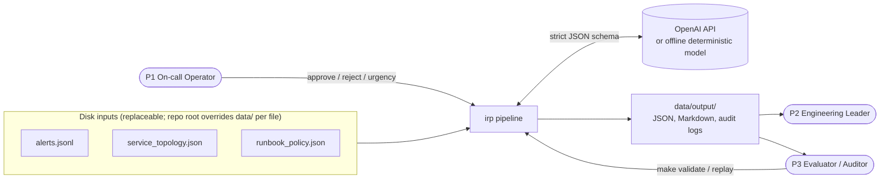
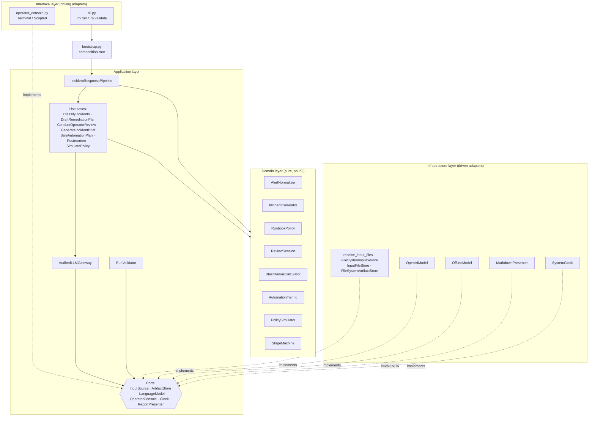
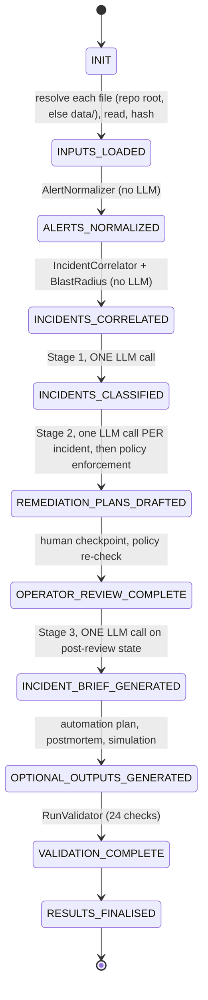
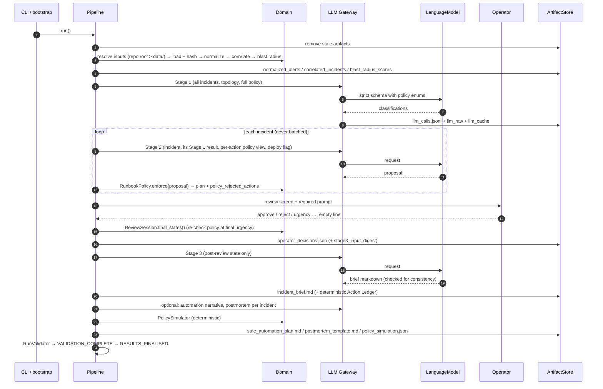
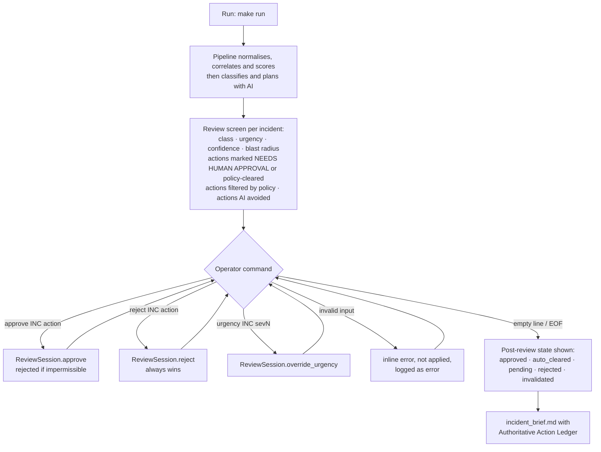
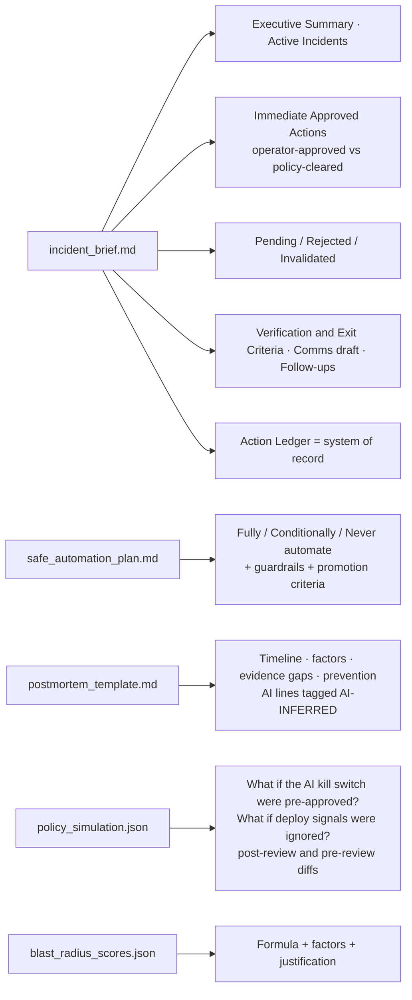
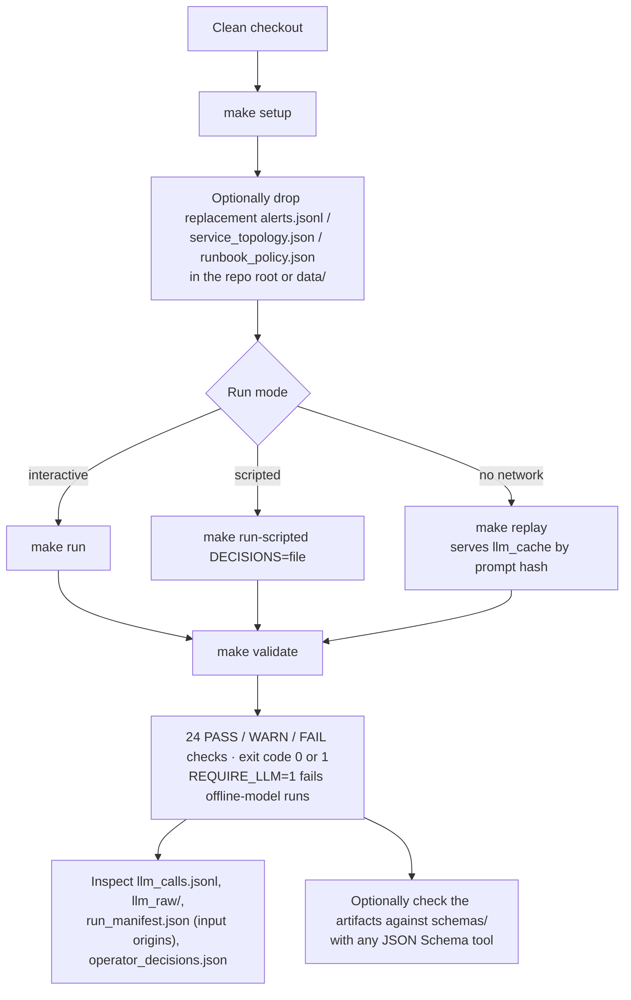
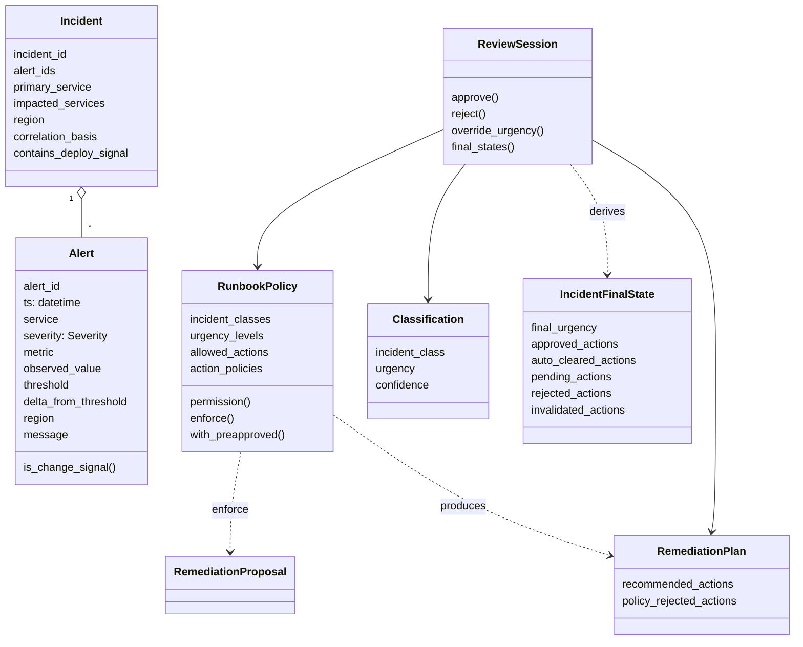

# Implementation Spec — AI-Assisted Incident-Response Control Plane

| | |
|---|---|
| **Status** | Implemented. 213 tests passing (including Hypothesis property tests), 99% line coverage, `make validate` 24/24 (an offline-model run passes with 1 WARN) |
| **Source requirement** | [`REQUIREMENT.md`](REQUIREMENT.md) |
| **Functional baseline** | [`BRD.md`](BRD.md) (personas P1–P3, use cases UC-01 to UC-12, resolved self-check findings) |
| **Scope of this document** | How the BRD is realised: architecture, workflows, technology, layers, boundaries |

---

## Table of Contents
1. [Purpose and Design Principles](#1-purpose-and-design-principles)
2. [Solution Architecture](#2-solution-architecture)
3. [Application Architecture Layers](#3-application-architecture-layers)
4. [Overall Workflow](#4-overall-workflow)
5. [Workflows per Persona](#5-workflows-per-persona)
6. [Domain Model](#6-domain-model)
7. [Deterministic Algorithms](#7-deterministic-algorithms)
8. [AI Integration and Safety Gates](#8-ai-integration-and-safety-gates)
9. [Artifacts and Audit Trail](#9-artifacts-and-audit-trail)
10. [Technology Stack](#10-technology-stack)
11. [Testing Strategy](#11-testing-strategy)
12. [Configuration and Operation](#12-configuration-and-operation)
13. [Requirement Traceability](#13-requirement-traceability)
14. [Out of Scope](#14-out-of-scope)

---

## 1. Purpose and Design Principles

The system is a **staged, replayable control-plane workflow**. It turns raw platform telemetry into an execution-ready incident briefing. An LLM is used **only where judgement is needed** (classification, remediation drafting, narrative), and that judgement is constrained by policy and gated by a human.

| Principle | How it is realised |
|---|---|
| **Separate analysis from action** | Nothing is executed. Every AI output is labelled *recommendation*. Only operator decisions, plus policy, produce an "approved" status. |
| **Determinism where it matters** | Normalisation, correlation, blast radius, policy enforcement, review application and what-if simulation are pure domain code with no LLM. |
| **Policy is the source of truth** | `RunbookPolicy` decides permissions and approval needs. The LLM's approval flag is overwritten, and disallowed actions are filtered out and recorded. |
| **Human in the loop** | A mandatory review checkpoint sits before the brief. Decisions are re-checked against policy at the final urgency. |
| **Auditability** | Every stage transition is timestamped. Every LLM call is logged with real artifact paths and whether the provider is a real LLM, and the raw request and response are kept. The path, origin and hash of each input are recorded. A validator re-derives the state from the files the run actually used and checks the artifacts against published JSON Schemas. |
| **Replayability** | LLM responses are cached by prompt hash, operator decisions can be scripted, and prompts contain no wall-clock data. |
| **Clean architecture** | Layered and hexagonal (ports and adapters). Domain-Driven Design aggregates and value objects. Dependencies point inward only. |

---

## 2. Solution Architecture

### 2.1 Context



### 2.2 Hexagonal view (ports and adapters)



**Dependency rule:** `interface → application → domain` and `infrastructure → application (ports) → domain`. The domain imports nothing from the other layers. The application layer depends only on the domain and on its own port protocols. `bootstrap.py` is the only module that knows the concrete adapters.

---

## 3. Application Architecture Layers

```
src/irp/
├── domain/            # Layer 1: business rules (Pydantic value objects, domain services)
├── application/       # Layer 2: use cases, ports, LLM contracts, gateway, validator, prompts
├── infrastructure/    # Layer 3: adapters for files, OpenAI, offline model, presenter, clock
├── interface/         # Layer 4: CLI (run / validate / schemas) and operator consoles (driving adapters)
├── shared/            # cross-cutting pure helpers (canonical JSON, hashing, path display)
└── bootstrap.py       # composition root (dependency injection)

<repo root>/*.json(l)  # optional replacement inputs (take precedence over data/, per file)
schemas/               # published JSON Schemas for the generated artifacts (`make schemas`)
data/                  # bundled inputs: alerts.jsonl, service_topology.json, runbook_policy.json
└── output/            # all generated artifacts, llm_raw/, llm_cache/ (git-ignored)
scripts/               # start.sh · stop.sh · status.sh · restart.sh
.github/workflows/     # ci.yml (GitHub Actions)
fixtures/              # sample_decisions.txt (scripted operator review)
docs/                  # REQUIREMENT.md · BRD.md · IMPLEMENTATION_SPEC.md (this file) · TEST_SUMMARY.md
```

### 3.1 Domain layer (`src/irp/domain`)

| Module | Kind | Responsibility |
|---|---|---|
| `alerts.py` | Value objects + domain service | `RawAlertRecord`, `Alert`, `Severity`; `AlertNormalizer` (deterministic IDs, UTC timestamps, delta, rejection reasons) |
| `topology.py` | Value object | `ServiceTopology`: transitive upstream/downstream, causal adjacency, tiers, cycle-safe walks |
| `incident.py` | Entity + domain service | `Incident`; `IncidentCorrelator` (union-find correlation, change-signal attachment, primary service) |
| `policy.py` | Aggregate root | `RunbookPolicy`: permission (class OR urgency allow-list), approval need, `enforce()` of AI proposals, `with_preapproved()` |
| `remediation.py` | Value objects | `Classification`, `RemediationProposal` (raw AI), `RemediationPlan` (policy-enforced), `PolicyRejection` |
| `review.py` | Aggregate | `ReviewSession`: approve, reject and urgency-override commands; post-review `IncidentFinalState` with policy re-check |
| `blast_radius.py` | Domain service | `BlastRadiusCalculator`: published 0–100 formula with per-factor breakdown |
| `automation.py` | Domain service | `AutomationTiering`: fully, conditionally or never automatable, with guardrails |
| `simulation.py` | Domain service | `PolicySimulator`: deterministic what-ifs (pre-approved AI kill switch; ignore deploy signals) |
| `pipeline_stage.py` | Domain service | `Stage` enum + `StageMachine`: strict order, guards such as "LLM only after correlation" and "brief only after review" |
| `errors.py` | Exceptions | `DomainError`, `NormalizationError`, `InvalidDecisionError`, `StageOrderError` |

### 3.2 Application layer (`src/irp/application`)

| Module | Responsibility |
|---|---|
| `ports.py` | Protocols: `InputSource`, `ArtifactStore`, `LanguageModel` (with `is_llm`), `OperatorConsole`, `Clock`, `ReportPresenter`; DTOs `PipelineInputs`, `LLMRequest` |
| `contracts.py` | **Runtime-generated Pydantic response models.** `Literal` enums come from the loaded policy and incident IDs. Also the strict JSON-schema conversion, brief sections and ledger heading. |
| `llm_gateway.py` | `AuditedLLMGateway`: stage guard, schema and semantic validation, one corrective retry, `llm_calls.jsonl` (logical artifact names resolved to real paths plus `input_sections` / `output_section`), `llm_raw/`, `llm_cache/` replay |
| `use_cases/*` | One class per use case (UC-03 to UC-10) |
| `pipeline.py` | `IncidentResponsePipeline`: orchestrates the 11 stages, persists the run manifest (input provenance and notices, stage history), maps artifact names to paths, and records a `termination` (aborted/failed + last completed stage) on interruption or error |
| `validation.py` | `RunValidator`: 24 checks against the persisted artifacts and the input files the run used (shared by the pipeline and `make validate`). A check can pass with a **warning**; `require_llm=True` turns the non-LLM-provider warning into a failure. |
| `artifact_schemas.py` | **Published artifact contracts.** Pydantic models of the requirement's artifact formats (extra fields allowed), used by the validator and exported by `irp schemas` as JSON Schema draft 2020-12 to `schemas/` |
| `documents.py` | Persisted document models (`OperatorDecisionsDocument`, `IncidentAnalysisDocument`, …) and presenter view models |
| `review_commands.py` | The operator command grammar and the exact prompt text required by the specification |
| `prompts/*.md` | Prompt templates. Data is injected at runtime and never hardcoded. |

### 3.3 Infrastructure layer (`src/irp/infrastructure`)

| Adapter | Port | Notes |
|---|---|---|
| `resolve_input_files` / `FileSystemInputSource` / `InputFileStore` | `InputSource` | Resolves each input (repo root first, then `data/`, or `--input-dir`), reads it and records path, origin, SHA-256, size and read time. Malformed alert lines become `RawAlertRecord(parse_error=…)`. |
| `FileSystemArtifactStore` | `ArtifactStore` | Atomic writes, JSONL append, path-traversal guard, byte-exact SHA-256 |
| `OpenAIModel` | `LanguageModel` | Chat Completions with Structured Outputs (`strict: true`), temperature 0, seed 7, fallback for models without `temperature`. `is_llm = True`. |
| `OfflineModel` | `LanguageModel` | Rule-based stand-in following the same contract. Every label it emits comes from the payload's policy. `is_llm = False`, so every run that uses it is flagged (§8.1). |
| `MarkdownPresenter` | `ReportPresenter` | Review screen, incident brief header and **Authoritative Action Ledger**, automation plan, postmortem |
| `SystemClock` / `FixedStepClock` | `Clock` | UTC microsecond timestamps; deterministic clock for tests |

### 3.4 Interface layer (`src/irp/interface`)

| Module | Responsibility |
|---|---|
| `cli.py` | `irp run` / `irp validate [--require-llm]` / `irp schemas [--check]`; validation output marks each check `PASS`, `FAIL` or `WARN`; minimal `.env` loader (never overrides existing environment variables); SIGTERM is turned into a graceful abort; exit codes 0 ok, 1 error, 2 validation failed, 130 stopped/interrupted. `irp validate` checks the inputs recorded in the run manifest unless `--input-dir` is given. |
| `operator_console.py` | `TerminalOperatorConsole` (TTY or piped stdin) and `ScriptedOperatorConsole` (decisions file, `#` comments) |

---

## 4. Overall Workflow

### 4.1 Stage machine (enforced in code)



Guards:
- `AuditedLLMGateway.run()` raises `StageOrderError` if called before `INCIDENTS_CORRELATED`.
- `GenerateIncidentBrief` requires exactly `OPERATOR_REVIEW_COMPLETE`.
- Skipping a stage or repeating one raises an error.
- An interruption (Ctrl-C, or SIGTERM from `scripts/stop.sh`) or an error is recorded in `run_manifest.json` → `termination` with the last completed stage. Artifacts written so far are kept.

### 4.2 End-to-end sequence



---

## 5. Workflows per Persona

### 5.1 P1: On-call Incident Commander (UC-01 to UC-07)

**Goal:** turn an alert storm into a few incidents fast, then clear only safe actions.



Post-review status rules (domain `ReviewSession`):

| Situation | Resulting status |
|---|---|
| Operator rejected | `rejected` (always wins) |
| Impermissible at the final urgency (e.g. a sev3 downgrade removes `page_platform_lead`) | `invalidated_by_override` (an earlier approval is voided) |
| Operator approved and permitted | `approved` |
| Newly permitted only because of an urgency override | `pending_approval` (origin `policy_unlocked`), never auto-cleared |
| Policy needs no approval and the operator did not reject | `auto_cleared_by_policy` |
| Policy needs approval and there was no decision | `pending_approval` |

### 5.2 P2: Engineering Leader (UC-06, UC-08 to UC-10)

**Goal:** a trustworthy briefing; know what is approved, pending or rejected; plan future automation safely.



### 5.3 P3: Evaluator / Auditor (UC-11, UC-12)

**Goal:** prove the run is correct, policy-compliant and reproducible on replaced inputs.



---

## 6. Domain Model



All domain objects are **immutable Pydantic models** (`frozen=True`, `extra="forbid"`) with full type hints. Aggregates with behaviour (`ReviewSession`, `StageMachine`) are plain typed classes that hold state privately.

---

## 7. Deterministic Algorithms

### 7.1 Normalisation
- `alert_id = ALR-<row:04d>-<sha256(canonical raw payload)[:8]>`, stable for a given file.
- `ts` is converted to UTC with a `Z` suffix; offset and naive timestamps are supported.
- Severity is case-insensitive and must be `info`, `warning` or `critical`.
- Numeric strings are accepted; booleans are rejected.
- `delta_from_threshold = observed_value − threshold`.
- Invalid rows are rejected with their line number and recorded in the manifest. `--strict` fails fast instead.

### 7.2 Correlation
1. Alerts are split into **symptoms** and **change signals** (metric `deploy|release|rollout|change`, or message `deploy|canary|rollout|release`).
2. Two symptoms are linked (union-find, so links chain) when they are in the **same region**, satisfy **|Δt| ≤ window** (default 120 s, inclusive), and are **causally adjacent**: the same service, or one service transitively depends on the other.
3. Each change signal attaches to the best eligible incident: same region, within the window of the incident's span, and adjacent to one of its alerting services. Preference order is same service, then smallest gap, then lowest index. Otherwise it becomes its own incident. Change signals never merge incidents.
4. Derived fields:
   - `primary_service`: the most upstream alerting service; ties are broken by maximum severity, then first seen, then name.
   - `impacted_services`: alerting services plus their transitive dependents.
   - `correlation_basis`: human-readable reasons for the grouping.

### 7.3 Blast radius (0–100)
`score = min(100, S + C + V + O + D)`

| Factor | Rule | Points |
|---|---|---|
| S | impacted services | `min(30, 10 × n)` |
| C | any impacted service has tier `critical_path` | 25 |
| V | maximum severity | critical 20 · warning 10 · info 0 |
| O | order routing impacted: name matches `order\|execution\|routing\|router` (configurable), else a critical-path sink | 15 |
| D | deploy/change signal present | 10 |

### 7.4 Policy enforcement
- An action is permitted when it is in `allowed_actions` **and** the incident's class **or** urgency is in `max_allowed_if`.
- An action with no policy entry is permitted but always human-gated.
- `requires_human_approval` is **always taken from the policy**. When the LLM's flag differs, it is recorded as `llm_approval_flag_mismatch`.
- Disallowed and duplicate actions go to `policy_rejected_actions`, with reasons.

### 7.5 What-if simulation (no LLM)
- **A:** `disable_ai_assist_path` is pre-approved in a copy of the policy, the plans are re-enforced, and the operator decisions are replayed.
- **B:** change signals are dropped, correlation and blast radius are recomputed, and deploy-dependent actions are removed (rollback-type always; freeze-type when the class is deployment-related). Deployment-classed incidents are flagged `requires_reclassification`.
- Both scenarios report a post-review `diff` and a `pre_review_diff`, so an operator decision cannot hide the effect of a policy change.

---

## 8. AI Integration and Safety Gates

| Call | Count | Input | Output contract | Post-processing |
|---|---|---|---|---|
| `stage1_classification` | 1 | all incidents, normalised alerts, full topology, full policy, class and urgency lists, blast scores | `ClassificationResponse` with `Literal` enums from the policy and incident IDs | semantic check: every incident exactly once |
| `stage2_remediation` | 1 per incident | incident, its alerts, its Stage 1 result, per-action policy view, `allowed_actions`, deploy flag, blast score | `RemediationResponse` (action enum = `allowed_actions`, ID fixed, at least 1 action) | `RunbookPolicy.enforce()` |
| `stage3_brief` | 1 | post-review state only (incidents, Stage 1, Stage 2, decisions, final urgencies, final action sets, blast) | `BriefResponse` | semantic check: 8 sections in order, final urgencies, each action listed in the right section; header and ledger added by code |
| `optional_automation_plan` | 1 | deterministic tiers, final state, policy | narrative | rendered under "AI Commentary" |
| `optional_postmortem` | 1 per incident | incident, alerts, Stage 1, Stage 2, final state | factors and prevention lists | every line tagged `[AI-INFERRED – unverified]` |

The gateway's controls, in order:
1. Stage guard.
2. Strict JSON schema at the provider.
3. Pydantic validation.
4. Semantic validation.
5. **One corrective retry** with the errors fed back.
6. Hard failure with a logged `status: failed` record.

The provider is chosen by `--provider auto|openai|offline`. `auto` uses OpenAI when `OPENAI_API_KEY` is set (environment or `.env`) and the offline model otherwise.

### 8.1 Runs without a real LLM

The offline model lets the pipeline run with no key, but it is a rule-based stand-in, not the "policy-constrained LLM analysis" the requirement asks for. An evaluator who runs without a key must not mistake such a run for an LLM run, so the `LanguageModel` port carries `is_llm`, and a run with `is_llm = False` is flagged in five places:

| Where | What |
|---|---|
| Console | A `WARNING … NOT a language model` banner at the start and at the end of the run |
| `run_manifest.json` | `llm_provider.is_llm: false` |
| `llm_calls.jsonl` | `provider_is_llm: false` on every record |
| Generated Markdown | the provider label reads `offline-deterministic:rule-based-v1 [rule-based stand-in, NOT an LLM]` |
| Validator | check *AI stages were answered by a real LLM* is **WARN**, or **FAIL** with `--require-llm` / `make validate REQUIRE_LLM=1` |

The run still succeeds (exit 0) by default, because the offline model is how tests and CI exercise the pipeline mechanics. The opt-in live CI job validates with `REQUIRE_LLM=1`.

---

## 9. Artifacts and Audit Trail

Every artifact below is written to `data/output/` (configurable with `--out-dir`).

**Input resolution** (`infrastructure/input_locator.py`): without `--input-dir`, each of the three input files is resolved independently. A file in the repo root takes precedence (where an evaluator is likely to drop replacement fixtures); otherwise the bundled `data/<file>` is used. A file found in neither place is an error naming both paths. When a repo-root file overrides a *different* bundled copy, a `NOTICE` is printed and stored in `run_manifest.json` → `input_notices`. Each input's path, `origin` (`repo_root`, `data_dir` or `explicit`) and SHA-256 are recorded, and the standalone validator re-checks **those exact files**, so a fixture changed after the run is caught.

**Published JSON Schemas** (`schemas/`, from `application/artifact_schemas.py`): one JSON Schema (draft 2020-12) per generated artifact whose format the requirement sets: `normalized_alerts`, `correlated_incidents`, `incident_analysis`, `operator_decisions`, `blast_radius_scores`, `policy_simulation`, and a per-line schema for `llm_calls.jsonl`. They fix the fields the requirement names and allow extra fields. Policy-dependent values (classes, urgencies, action names) are strings, because membership depends on the fixture; the validator checks it against the policy the run used. The validator applies the same models, `irp schemas --check` (run in CI) and a test fail if the committed files drift, and a test validates real run artifacts against the committed files with the third-party `jsonschema` library.

**`llm_calls.jsonl` paths:** `input_artifacts` and `output_artifact` hold real file paths, relative to the working directory (e.g. `data/runbook_policy.json`, `data/output/incident_analysis.json`). When a call reads or writes one part of a file, that part is named separately in `input_sections` / `output_section` (e.g. `stage1`, `stage2.INC-001`). The validator checks that every logged path exists.

| Artifact | Produced at | Contents |
|---|---|---|
| `normalized_alerts.json` | ALERTS_NORMALIZED | required fields + `source_line` |
| `correlated_incidents.json` | INCIDENTS_CORRELATED | required fields + `alerting_services`, `deploy_alert_ids`, `start_ts`/`end_ts`, `max_severity`, `tiers`, `critical_path_services` |
| `blast_radius_scores.json` | INCIDENTS_CORRELATED | formula, per-incident score, factors, justification |
| `incident_analysis.json` | INCIDENTS_CLASSIFIED / REMEDIATION_PLANS_DRAFTED | `stage1` (preserved), `stage2` (appended per incident, including `policy_rejected_actions`) |
| `operator_decisions.json` | OPERATOR_REVIEW_COMPLETE | operator, mode, prompt, raw commands (including errors), decisions, per-incident `final_state`, `stage3_input_digest` |
| `incident_brief.md` | INCIDENT_BRIEF_GENERATED | AI banner, 8 sections, deterministic **Authoritative Action Ledger** |
| `safe_automation_plan.md`, `postmortem_template.md`, `policy_simulation.json` | OPTIONAL_OUTPUTS_GENERATED | see §5.2 |
| `llm_calls.jsonl` | every LLM call | `stage, incident_id, timestamp, provider, model, prompt_hash, input_artifacts, output_artifact` (real paths) + `provider_is_llm, input_sections, output_section, call_id, attempts, status, latency_ms, errors, pipeline_stage_at_call, raw_record` |
| `llm_raw/<call_id>.json` | every LLM call | full messages, schema, payload digest, response (git-ignored) |
| `llm_cache/<prompt_hash>.json` | successful live calls | response for `--replay` (git-ignored by default) |
| `run_manifest.json` | every stage | input provenance (path, origin, SHA-256, bytes, read time), `input_notices`, settings, provider (with `is_llm`), timestamped stage history with details, `termination` if stopped or failed |

**How the validator proves operator decisions reached Stage 3:** `operator_decisions.stage3_input_digest` must equal the `payload_digest` of the logged Stage 3 request. The Stage 3 payload must carry the same final urgencies and action sets. Replaying the logged decisions over the saved AI plans must reproduce the saved `final_state` exactly.

---

## 10. Technology Stack

| Layer / concern | Choice | Why |
|---|---|---|
| Language | **Python ≥ 3.11** (run on 3.12) | Strong typing (`X \| None`, `Literal`), rich stdlib, the default for AI and agent tooling |
| Package / env management | **uv** + `pyproject.toml` (hatchling build) | Fast, reproducible installs; `uv run` needs no manual activation |
| Domain and contract modelling | **Pydantic v2** | Immutable value objects, validation at boundaries, **runtime `create_model` with `Literal` enums** to generate strict JSON schemas from the policy |
| Type hints | Throughout (`from __future__ import annotations`, `Protocol` ports) | Clear contracts between layers |
| LLM provider | **OpenAI** (`openai` SDK, Chat Completions + Structured Outputs `strict: true`); model from `OPENAI_MODEL` (default `gpt-4.1`) | Schema-constrained output; temperature 0 and a fixed seed for stability |
| Offline provider | Built-in `OfflineModel` | Runs end to end with no key; deterministic CI. Flagged as not an LLM (§8.1). |
| Artifact contracts | Pydantic models exported as **JSON Schema draft 2020-12** (`schemas/`) | Evaluators can check artifacts with any JSON Schema tool; no extra runtime dependency |
| Persistence | Local filesystem: inputs in `data/`, outputs in `data/output/` (JSON / JSONL / Markdown), atomic writes | Required artifact formats; diffable; evaluator-friendly |
| CLI | `argparse` (stdlib), `irp` console script | No extra dependency |
| Secrets | `.env` (git-ignored), minimal built-in loader | No dependency; environment variables take precedence |
| Testing | **pytest** + **pytest-cov**; **Hypothesis** (property-based tests); **jsonschema** (third-party check of the published schemas) | 213 tests: unit (domain, application, infrastructure, interface), property-based and integration. Hypothesis and jsonschema are dev-only. |
| Build / run | **Makefile** + **bash scripts** | `setup`, `run`, `run-scripted`, `replay`, `start`/`start-bg`/`stop`/`status`/`restart`, `validate`, `schemas`, `test`, `coverage`, `clean` |
| CI | **GitHub Actions** (`.github/workflows/ci.yml`) | pytest + coverage gate (95%) on Python 3.11/3.12/3.13; offline end-to-end run, schema drift check, validate, replay and script smoke test; opt-in live OpenAI job validated with `REQUIRE_LLM=1` |

Runtime dependencies are `openai` and `pydantic` only.

---

## 11. Testing Strategy

Latest results: [`TEST_SUMMARY.md`](TEST_SUMMARY.md).

```
tests/
├── conftest.py, fakes.py              # builders, FakeModel, MemoryStore, ListConsole
├── unit/domain/                       # 95 tests: normaliser, topology, correlator, policy, review, blast radius,
│                                      #           automation tiers, simulator, stage machine
├── unit/application/                  # contracts (dynamic enums, strict schema), gateway (retry, replay, stage guard,
│                                      #           hashing), command parser, review use case, brief consistency
├── unit/infrastructure/               # input file resolution, filesystem adapters, offline model, OpenAI adapter
│                                      #   (mocked client), CLI, consoles
├── property/                          # Hypothesis: random topologies (cycles included), alert streams and AI proposals
│                                      #   against the normaliser, correlator, blast radius and policy enforcement
└── integration/                       # end-to-end runs, replay, decision impact, tamper detection, replaced fixtures,
                                       #   evaluator scenarios (repo-root replacements, validating the files used),
                                       #   run lifecycle (interrupt/failure recorded, start/stop/status scripts),
                                       #   non-LLM flagging and --require-llm, published schemas (drift, jsonschema)
```

**Property-based tests** (`tests/property/`, 150 generated examples per property). Example tests pin known fixtures; these check the invariants that must hold for *any* equivalent fixture:

| Property | Stage |
|---|---|
| Normalising the same rows twice gives identical alerts; IDs are unique; output is time-sorted, UTC, with an exact delta | Normalisation |
| `alert_id` does not depend on JSON key order | Normalisation |
| Every alert belongs to exactly one incident; incident IDs are `INC-001…` in order | Correlation |
| Correlation is deterministic and independent of input order | Correlation |
| Each incident has one region, a correct deploy flag, a primary service among its alerts, and a correlation basis | Correlation |
| Any two symptoms that meet the link rule (region, window, causal adjacency) share an incident | Correlation |
| Change signals never merge incidents (removing them leaves the symptom grouping unchanged) | Correlation |
| Blast radius is in 0–100, equals the capped sum of its factors, and is deterministic | Blast radius |
| An enforced plan keeps only permitted, de-duplicated actions, with approval flags from the policy; everything else is recorded as rejected | Policy |

A deliberately broken correlator (an extra link condition) is caught by these tests, which confirms they are not vacuous.

Edge cases covered include:
- **Input files:** replacements in the repo root override `data/` per file; a notice appears only when the override differs; root-only layout; a file missing from both locations; an incomplete `--input-dir`; an input changed after the run.
- **Alerts:** malformed or blank JSON lines; missing fields; bad severity, timestamp or numbers; boolean values; timezone offsets; unsorted input; empty input.
- **Topology:** services missing from the topology; cyclic topology; inclusive window boundary; chained windows; siblings joined only through a common dependent.
- **Change signals:** an orphan deploy event; a deploy outside the window; a deploy never merges unrelated incidents.
- **Policy:** an action with no policy entry; duplicate or empty policy lists; a disallowed AI action; a wrong AI approval flag; a plan where everything is filtered out.
- **Review:** invalid incident, action or urgency; last decision wins; a downgrade voids an approval; an upgrade unlocks an action as pending; decision order does not matter; EOF without a blank line.
- **LLM gateway:** schema violation then retry; semantic failure; provider exception; LLM call before correlation; replay cache miss; logical names resolved to real paths and sections.
- **OpenAI adapter:** temperature fallback; refusal; a 401 error propagates.
- **LLM provider:** offline runs are flagged in the console, manifest, log and Markdown; `--require-llm` fails them; an LLM provider passes with no warning.
- **Published schemas:** committed files match the code and are valid draft 2020-12; real artifacts pass a third-party validator; missing fields, empty lists, unknown enum values, out-of-range scores and bad log timestamps fail both validators.
- **Validator:** detects an edited brief, changed inputs, a missing Stage 2 record, a disallowed action, tampered decisions, a missing artifact, a logged artifact path that does not exist and a corrupt manifest.
- **Replaced fixtures:** renamed services, a new region, new class names, `P1–P3` urgencies and an action with no policy entry.

---

## 12. Configuration and Operation

| Setting | Where | Default |
|---|---|---|
| `OPENAI_API_KEY` | `.env` or environment | unset → offline model |
| `OPENAI_MODEL` | `.env` or environment | `gpt-4.1` |
| `IRP_PROVIDER` / `--provider` | env / CLI | `auto` |
| `IRP_CORRELATION_WINDOW_S` / `--window` | env / CLI | `120` |
| `IRP_ORDER_PATH_PATTERN` | env | `order\|execution\|routing\|router` |
| `IRP_OPERATOR` | env | OS user |
| `--require-llm` | `irp validate` (`REQUIRE_LLM=1` in make) | off: a non-LLM run is a WARN, not a FAIL |
| `--input-dir` / `--out-dir` | CLI (`-i`/`-o` in scripts, `DATA_DIR`/`OUT_DIR` in make) | auto per file (repo root, else `data/`) / `data/output` |
| `--decisions-file`, `--replay`, `--strict`, `--skip-optional` | CLI | — |

```bash
make setup                                   # uv sync --group dev
make run                                     # interactive review (OpenAI if key present)
make run-scripted PROVIDER=offline           # scripted review, no network
make replay                                  # cached LLM responses, same decisions
make validate                                # 24 checks, exit 1 on failure
make validate REQUIRE_LLM=1                  # also fail if the AI stages did not use a real LLM
make schemas                                 # regenerate schemas/ (irp schemas --check only reports drift)
make test / make coverage
make start | start-bg | stop | status | restart     # MODE=…, PROVIDER=…, DECISIONS=…, DATA_DIR=…, OUT_DIR=…

scripts/start.sh [-m interactive|scripted|replay] [-p auto|openai|offline] [-b]   # start a run (PID in .run/)
scripts/status.sh                                                               # RUNNING/IDLE + last stage
scripts/stop.sh [-t 15] [-f]                                                    # SIGTERM → manifest 'termination' → exit 130
scripts/restart.sh [start options]
```

---

## 13. Requirement Traceability

| Requirement (REQUIREMENT.md) | BRD UC | Implementation |
|---|---|---|
| 1 Deterministic normalisation | UC-01 | `domain/alerts.py`, `infrastructure/filesystem.py` |
| 2 Deterministic correlation | UC-02 | `domain/incident.py`, `domain/topology.py` |
| 3 Stage 1 classification | UC-03 | `use_cases/classify_incidents.py`, `contracts.classification_contract` |
| 4 Stage 2 remediation per incident | UC-04 | `use_cases/draft_remediation.py`, `RunbookPolicy.enforce` |
| 5 Operator review checkpoint | UC-05 | `use_cases/conduct_review.py`, `domain/review.py`, `interface/operator_console.py` |
| 6 Incident brief | UC-06 | `use_cases/generate_brief.py`, `MarkdownPresenter.incident_brief` |
| 7 Blast radius | UC-07 | `domain/blast_radius.py` |
| 8 Safe automation plan | UC-08 | `domain/automation.py`, `GenerateSafeAutomationPlan` |
| 9 Postmortem skeleton | UC-09 | `GeneratePostmortemSkeleton`, `MarkdownPresenter.postmortem` |
| 10 What-if simulation | UC-10 | `domain/simulation.py` |
| Stage machine | — | `domain/pipeline_stage.py`, `application/pipeline.py` |
| `llm_calls.jsonl` | UC-11 | `application/llm_gateway.py` |
| Validation command | UC-11 | `application/validation.py`, `validate.py`, `make validate` |
| "Policy-constrained LLM analysis" (no silent non-LLM runs) | UC-03, UC-04, UC-06, UC-11 | `LanguageModel.is_llm`, pipeline warning banner, `provider_is_llm` in `llm_calls.jsonl`, validator check "AI stages were answered by a real LLM", `--require-llm` |
| Required artifact formats | UC-11 | `application/artifact_schemas.py`, `schemas/*.schema.json`, validator check "artifacts conform to the published JSON Schemas" |
| Deterministic normalisation and correlation on any equivalent input | UC-01, UC-02, UC-07, UC-12 | `tests/property/test_deterministic_properties.py` (Hypothesis) |
| Input files read from disk; replaced fixtures | UC-01, UC-12 | `infrastructure/input_locator.py` (repo root > `data/`, per file), `FileSystemInputSource`, `tests/integration/test_evaluator_scenarios.py` |
| `llm_calls.jsonl` `input_artifacts` / `output_artifact` as paths | UC-11 | `AuditedLLMGateway._resolve_artifacts`, validator check "artifact paths exist on disk" |
| Clean-checkout re-run | UC-12 | `pipeline.run()` stale-artifact purge, `tests/integration/test_replaced_fixtures.py`, CI end-to-end job |
| Start / monitor / stop a run | UC-13 | `scripts/*.sh`, CLI SIGTERM handling, `pipeline` termination record, `tests/integration/test_lifecycle.py` |

---

## 14. Out of Scope

### 14.1 Out-of-scope requirements

| # | Item | Reason |
|---|---|---|
| OOS-R1 | **Executing any infrastructure action** (paging, rollback, traffic shift, quote fallback, deploy freeze, kill switch) | The challenge is planning and control-plane output only. "Approved" means approved for execution by humans. |
| OOS-R2 | Live streaming ingestion, polling real monitoring systems (Prometheus, Datadog, CloudWatch) or message buses | Inputs are "live-like" files on disk; replayability requires file inputs |
| OOS-R3 | LLM-based parsing, normalisation, correlation or scoring | Explicitly forbidden; these must be deterministic code |
| OOS-R4 | Chat or conversational interface; web UI or dashboard | The challenge states "not a chat interface" and "not a monitoring dashboard" |
| OOS-R5 | Publishing the status page or sending communications | Communications are **drafts** only and marked as not published |
| OOS-R6 | Authentication, RBAC and multi-operator approval (two-person rule) | Single-operator CLI checkpoint; operator identity is recorded from the environment |
| OOS-R7 | Persistent database, multi-run history and incident deduplication across runs | Each run is self-contained and regenerated from disk. **Clarification:** `data/output/llm_cache/` keeps AI responses across runs, but only for `--replay`, looked up by exact prompt hash. It is never used as run history, for trends or for deduplication, so it is not multi-run history. |
| OOS-R8 | Re-classification inside the what-if simulation | It would need a new non-deterministic LLM call; affected incidents are flagged `requires_reclassification` instead |
| OOS-R9 | Multi-provider routing, provider failover or cost and latency budgets | One provider per run (OpenAI or offline); simple retry only |
| OOS-R10 | Ticketing, chat-ops or on-call platform integration (Jira, Slack, PagerDuty) | Recommendations only; no outward-facing actions |
| OOS-R11 | Editing the runbook policy from the tool | The policy is an input and the source of truth; what-ifs run on in-memory copies |
| OOS-R12 | Production hardening: running as a long-lived or supervised service (daemon with restart/respawn), horizontal scaling, encrypted artifact storage, PII redaction of prompts | Proof-of-concept scope; `llm_raw/` and `.env` are git-ignored. **Clarification:** `scripts/start.sh -b` only detaches a **single batch run**, tracked by a PID file, and ends when that run finishes. That is run control (BRD UC-13), not daemonisation. |

### 14.2 Out-of-scope use cases

| # | Use case (not supported) | Closest supported alternative |
|---|---|---|
| OOS-UC1 | "Auto-remediate when confidence is high" (or any automatic execution, including of policy-cleared actions) | `safe_automation_plan.md` gives tiers, guardrails and promotion criteria. **Clarification:** `auto_cleared_by_policy` is a *status*, not an action. It means the policy says the action needs no human approval and the operator did not reject it. Nothing is executed, and model confidence never changes an action's status. |
| OOS-UC2 | "Roll back the canary now" from the tool | The operator approves `rollback_latest_change`; the brief and ledger record it for human execution |
| OOS-UC3 | Operator asks the assistant follow-up questions mid-incident | Re-run with different decisions; replay keeps earlier AI output stable |
| OOS-UC4 | Merge incidents across regions, or across runs or days | Correlation requires a shared region and the time window within one input file |
| OOS-UC5 | Live alert suppression or deduplication at the source | The correlation basis explains the grouping; observability follow-ups are in the postmortem |
| OOS-UC6 | Continuous what-if exploration for arbitrary policy edits | Two fixed deterministic scenarios (A and B); new scenarios are added as domain methods |
| OOS-UC7 | Approval by several operators, with escalation timers | Pending actions are listed under "Actions Pending Human Approval or Escalation" |
| OOS-UC8 | Rendering the brief to PDF or HTML, or emailing it | Markdown artifact; any downstream tooling can render it |
